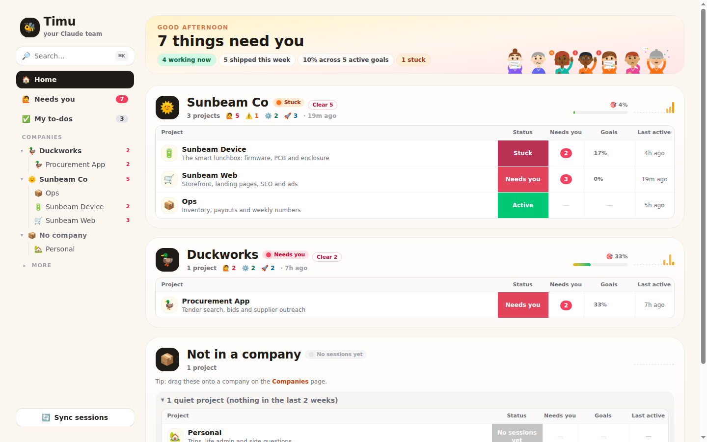
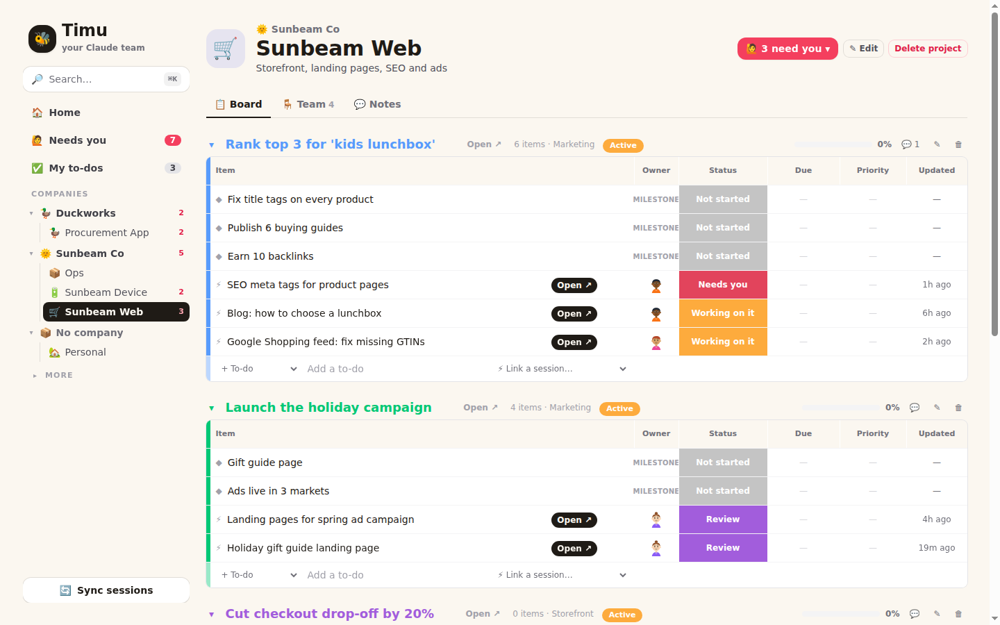
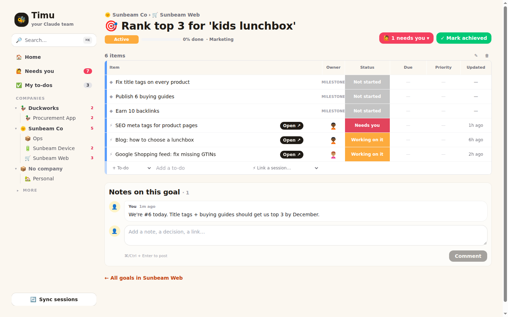
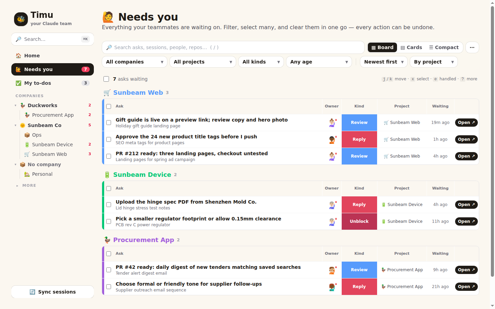
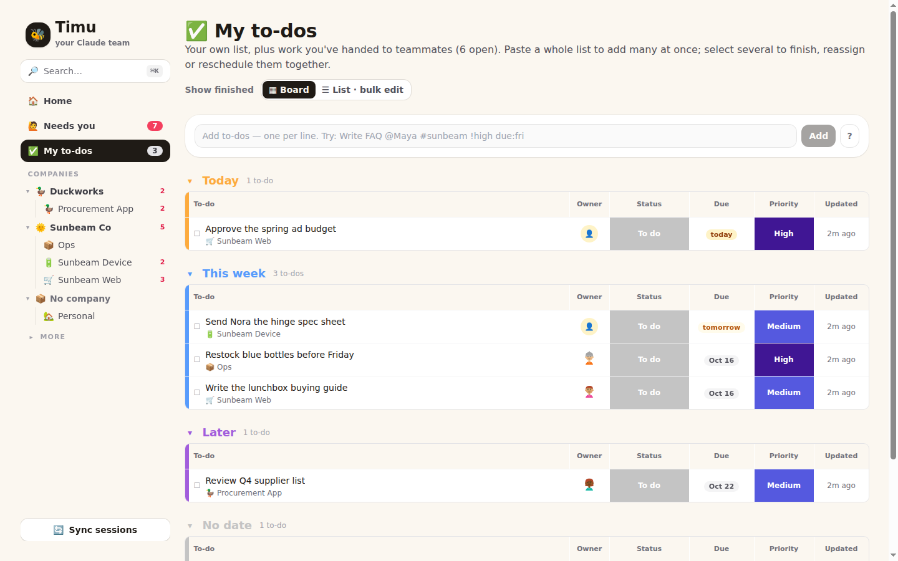
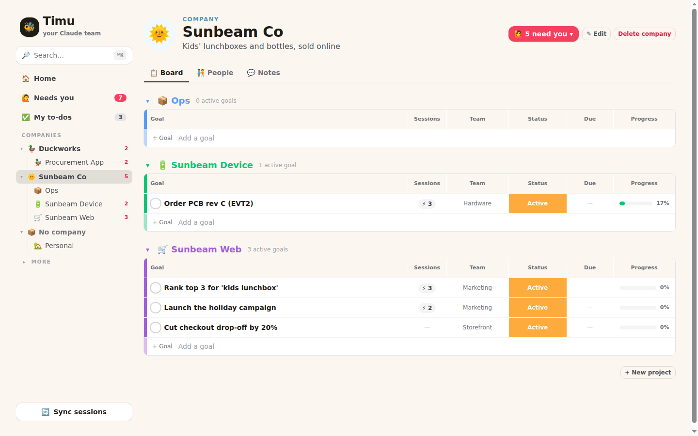
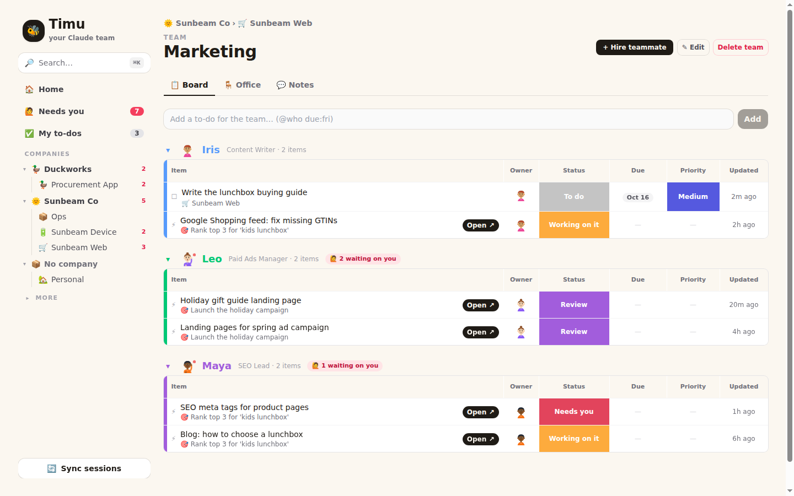
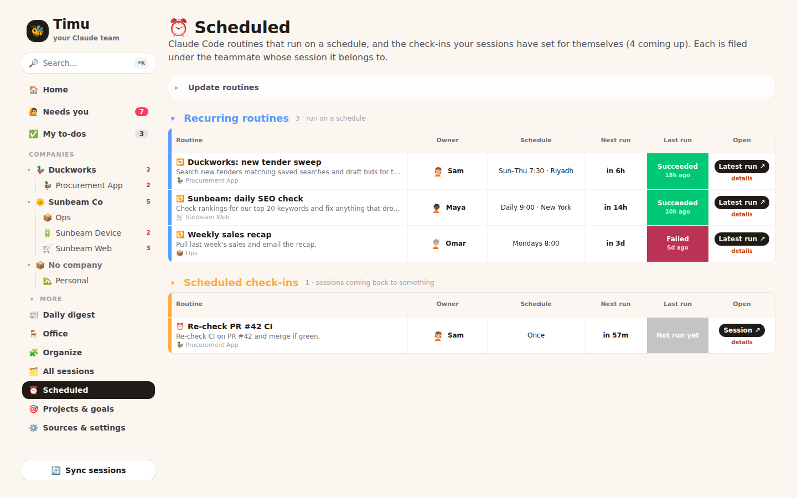
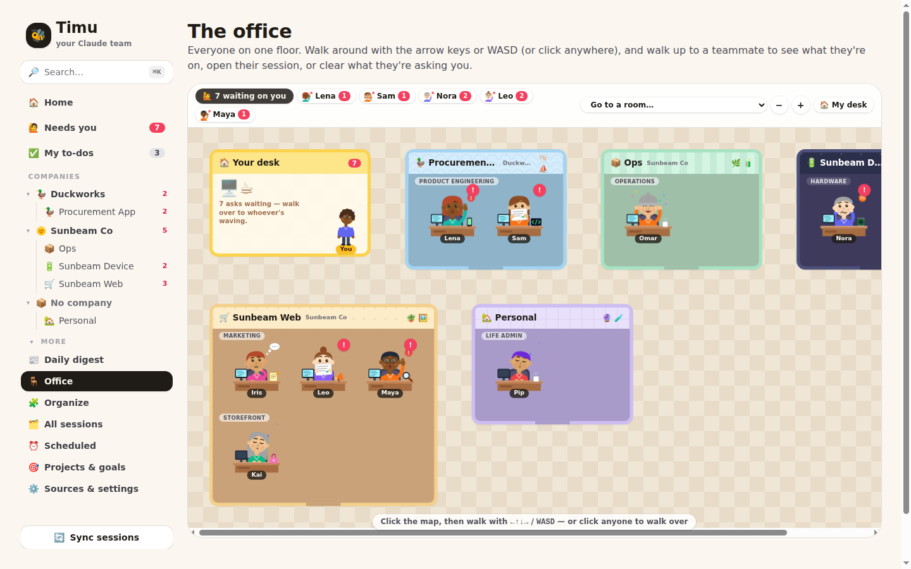

<p align="center">
  
</p>

<h1 align="center">Timu 🐝</h1>

<p align="center"><b>All your Claude sessions, run like a small company.</b><br>
Timu files every Claude Code and claude.ai session under a teammate, a team, a project and a goal, then shows you, on boards, the few things that actually need you.</p>

<p align="center">
  <a href="#install">Install</a> ·
  <a href="#your-first-five-minutes">First five minutes</a> ·
  <a href="#a-tour">Tour</a> ·
  <a href="#let-claude-run-timu-mcp">Let Claude run it</a> ·
  <a href="https://gehadshaat.github.io/timu/">Website</a>
</p>

---

## Install

You need **Node 22.16 or newer**. To pull in your sessions, you also need **Claude Code** signed in on the same machine. There's nothing else: no database server, Docker or cloud account. Timu keeps everything in one SQLite file.

```bash
git clone https://github.com/gehadshaat/timu.git
cd Timu
npm run setup     # installs everything and writes .env.local (safe to re-run)
npm run dev       # open http://localhost:3100
```

That's the only install. There's no API key to paste: Timu asks Claude through the Claude Code CLI (`claude -p`) on the login you already have, to file sessions and judge what needs you. Without the CLI, Timu uses rules instead.

> **Signing in to Claude is automatic.** Timu borrows the login Claude Code already has (`~/.claude/.credentials.json`) and re-reads it on every sync, so there's no token to copy. If it ever expires, Settings tells you to run `claude`, and the next sync picks it up. More than one Claude account? Sign in with `CLAUDE_CONFIG_DIR=~/.claude-work claude`, and Timu syncs both into the same companies and projects.

## Your first five minutes

1. **Open http://localhost:3100.** The first visit sends you to the setup wizard.
2. **Import sessions.** The wizard reads your local Claude Code transcripts and your cloud sessions on claude.ai/code. claude.ai chats are optional: upload your data export, or use the Chrome extension in `extension/`.
3. **Build the team, then review and hire.** Claude (or Timu's rules, without the Claude CLI) proposes companies, projects, teams and cartoon teammates, each owning a stream of sessions. Rename anyone and drop what you don't want; nothing is saved until you press **Hire the team 🎉**.
4. **Clear what needs you.** Home shows each company as a board. Click any red **Needs you** cell to mark it done, mark it not needed (it stays quiet until there's new activity) or snooze it. Every change has Undo.
5. **Let Claude help (optional).** Add Timu as an MCP server, with the command shown in **Settings → Let Claude run Timu**. Then ask Claude things like "file my unfiled sessions" or "what needs me today?".

After that, **Sync sessions** (bottom left) pulls new activity from every source and files new sessions with the right teammate.

## A tour

Every page is the same kind of board: coloured groups, one row per item, and status cells you click to change.

| | |
| --- | --- |
|  | **Project boards.** Each goal is a group. Its milestones, to-dos and sessions are rows with owner, status, due date and priority. Tick, reassign, reschedule or re-prioritise in place, and **Open** any session in Claude. |
|  | **Goal pages.** Everything working toward one goal, its notes, and a big **✓ Mark achieved** button. |
|  | **Needs you.** Everything waiting on you, grouped by project, company or kind. Click the kind to clear it, or select many and clear them in one go. Keyboard: `j`/`k`, `e`, `n`, `s`. |
|  | **My to-dos.** Grouped Overdue / Today / This week / Later. Quick-add understands `Write FAQ @Maya #sunbeam-web !high due:fri`. |
|  | **Companies.** A group per project and a row per goal. Tick a goal to mark it achieved, or open its sessions from the ⚡ column. |
|  | **Teams and people.** A group per teammate, with their to-dos and sessions. Set a session's status yourself: **Needs me**, **Done** or **Idle**. |
|  | **Scheduled.** Your Claude Code routines and the check-ins your sessions have set, each with its schedule in words, next run and last result. |
|  | **The office.** One walkable map, Gather style. Walk with WASD, see who's waving at you, and press **E** to talk to them, open their session or clear their asks. |

The screenshots use the demo companies Sunbeam Co and Duckworks.

## Sources

| Source | How | Live status? |
| --- | --- | --- |
| **Claude Code, local** | Reads `~/.claude/projects/*/*.jsonl` directly. You can override the path with `CLAUDE_PROJECTS_DIR`. | Partly: working, or waiting on you when the last reply asks a question |
| **Claude Code, cloud** (claude.ai/code) | Sessions API with a token, or paste or upload a JSON dump | Yes: working, blocked, review-ready, failed, plus the session's own "needs action" note |
| **claude.ai chats, export** | Upload the zip from claude.ai → Settings → Privacy → Export data | No |
| **claude.ai chats, extension** | The `extension/` Chrome extension syncs chats while you use claude.ai | Updates whenever claude.ai is open |

### Cloud sessions

Anthropic doesn't publish an API for listing claude.ai/code sessions. Timu offers two ways in:

1. **Direct pull (unofficial).** Timu signs in with your Claude Code login. On every sync it reads the current access token from Claude Code's credentials file (`~/.claude/.credentials.json`, or `CLAUDE_CREDENTIALS_PATH`), so there's nothing to paste.
   - Claude Code refreshes that token whenever you use it, and Timu picks up the new one on its next sync. If the login has expired, Settings says so; running `claude` fixes it.
   - On macOS, where Claude Code keeps the token in the Keychain, or to use a specific token, set `CLAUDE_SESSIONS_TOKEN`. Timu tries it first and falls back to the Claude Code login if Claude rejects it.
   - Timu calls `CLAUDE_SESSIONS_API_URL` the way the Claude Code CLI does. This endpoint and its headers are undocumented and may change. If the pull fails, the error appears on the Settings page.
2. **JSON dump (reliable).** In any Claude Code cloud session, ask Claude: *"Call list_sessions with limit 100 and give me the raw JSON"*. Then paste the result into **Settings → Claude Code · cloud → Paste or upload sessions JSON**. Timu accepts:
   - the API page (`{data: [...]}`)
   - a bare array
   - the `{ccr: …}` wrapper

   You can also POST the same JSON to `/api/ingest/cloud` with your ingest token.

### Several Claude accounts

Timu syncs every Claude account you use, and files them all into the same companies, projects, teams and goals.

- **What counts as an account:** each Claude Code config folder is one: the default `~/.claude`, plus any you sign in with via `CLAUDE_CONFIG_DIR=~/.claude-work claude`.
- **Finding them:** Timu picks up every `~/.claude-*` (or `~/.claude_*`) folder that has a login. To choose them yourself, set `CLAUDE_ACCOUNTS` to a comma-separated list of folders.
- **What syncs:** for each account, Timu pulls cloud sessions and routines with that account's own login and organisation, and reads its local transcripts from `<folder>/projects`.
- **Labels:** sessions and routines from accounts other than the default get a small badge. Settings shows each account's sign-in status.
- **Overrides:** the `CLAUDE_*` settings in `.env.local` apply to the first (default) account only.

### Routines and scheduled check-ins

The **⏰ Scheduled** page shows two kinds of scheduled Claude Code work. Both are made with `/schedule`. Each one is filed under the teammate and project of the session it belongs to.

- **Routines:** cloud agents that run on a cron schedule. The page shows the schedule in words, the next run, and how the last run went.
- **Check-ins:** one-off returns a session schedules for itself, such as "re-check PR #40 in an hour".

Timu offers two ways to get them:

1. **Sync (unofficial).** Every sync also pulls routines, using the same Claude login as cloud sessions.
   - Timu calls `/v1/code/triggers` the way Claude Code's routines tool does: with the `ccr-triggers-2026-01-30` beta header and your organisation id.
   - The organisation id comes from `CLAUDE_ORG_UUID`, or from the account Claude Code is signed in with (`~/.claude.json`).
   - To override the endpoint or the beta header, set `CLAUDE_ROUTINES_API_URL` or `CLAUDE_ROUTINES_BETA`.
2. **Paste (reliable).** In Claude Code, ask: *"Use RemoteTrigger list and give me the raw output"*. Paste the result on the Scheduled page under **Update routines**, or hand it to the `import_routines` MCP tool.

Claude can read them with the `list_routines` MCP tool.

### Artifacts

The **🖼️ Artifacts** page (under More) collects your Claude artifacts. Companies and projects each have an **Artifacts** tab with theirs; goal, team, person and session pages list the ones their sessions made, and 🖼️ chips on session and goal rows jump to them. There are two kinds:

- **Published artifacts:** pages on claude.ai (`claude.ai/artifact/…`).
- **Chat artifacts:** documents, code and apps Claude made inside your claude.ai chats.

How they get in:

- **From your sessions:** when a local Claude Code session publishes an artifact, Timu sees it in the transcript and links it to that session. Only actual publishes count; links a session merely mentions or lists don't. Chat artifacts come in with your claude.ai chats (export or Chrome extension).
- **Your whole gallery:** with Timu connected over MCP, ask Claude *"list my artifacts and import them into Timu"*. Or paste the list Claude prints under **Update artifacts**.

How they're filed:

- Under the project of the session that made them; otherwise, by matching their title to a project or company name.
- Click an artifact's project cell to move it. Artifacts you've moved stay where you put them.
- For Claude: the `list_artifacts`, `import_artifacts` and `move_artifact` MCP tools.

### Chrome extension

1. Open `chrome://extensions`, turn on **Developer mode**, click **Load unpacked**, and select `extension/`.
2. With Timu running locally, there's nothing to configure: the extension picks up the ingest token from `http://localhost:3100` by itself. For a hosted Timu, click the 🐝 icon, set the Timu URL and your `TIMU_INGEST_TOKEN`, then save.
3. Open claude.ai while signed in. The extension syncs chats that changed since its last run, and repeats every 10 minutes while the tab is open. **Sync now** in the popup forces a sync.

The extension reads claude.ai's own web API with your existing session cookies. It sends conversations only to the Timu URL you configure. That web API is unofficial, so if it changes, the data export still works.

## Let Claude run Timu (MCP)

Timu is also an MCP server, so Claude can do everything you can do in the UI: "file my unfiled sessions", "set up a Marketing team for Sunbeam with an SEO lead", "what needs me today?", "close the asks about merged PRs and remember that rule".

Everything the UI does in bulk works over MCP too: handle many asks at once, move, archive or re-file sessions, add to-dos in quick-add syntax (`Write FAQ @Maya #sunbeam !high due:fri`, one per line), add goals and milestones, hire several people, move people and projects. Changes that can be undone return an `undo_id` for the `undo` tool. Claude can also `search` by name and read or leave comments on any company, project, team, teammate, goal, session or to-do. It can also:

- set a session's status, like the board's status cell (`set_session_status`: needs_me / done / idle / claude);
- read and import your routines (`list_routines`, `import_routines`);
- read, import and file your artifacts at any level (`list_artifacts` by company, project, goal, teammate or session; `import_artifacts`; `move_artifact`).

`get_org`, `get_project`, `get_teammate` and `get_session` include the related artifacts.

`npm run setup` (or `npm run dev`) generates `TIMU_MCP_TOKEN` in `.env.local`. **Settings → Let Claude run Timu** shows the commands below with your URL filled in.

**Claude Code, while `npm run dev` is running:**

```bash
claude mcp add --transport http timu http://localhost:3100/api/mcp --header "Authorization: Bearer <TIMU_MCP_TOKEN>"
```

Replace `<TIMU_MCP_TOKEN>` with the value from `.env.local`. `npm run setup` prints this command with the token filled in.

**Claude Code or Claude Desktop on the same machine, without the web app.** This runs over stdio and opens the database file directly:

```bash
claude mcp add timu -- npm --prefix /path/to/Timu run -s mcp
```

For Claude Desktop, put the same command in `claude_desktop_config.json`: `"command": "npm", "args": ["--prefix", "/path/to/Timu", "run", "-s", "mcp"]`.

**claude.ai (or any client that can't send headers):** with Timu hosted, add a custom connector with the URL `https://your-timu…/api/mcp?token=<TIMU_MCP_TOKEN>`. URLs can end up in logs, so prefer the header wherever the client supports it.

What Claude can do:

| Area | Tools |
| --- | --- |
| Look around | `get_org` (the whole tree with workload), `get_project`, `get_teammate`, `list_sessions`, `get_session`, `get_inbox`, `list_todos`, `get_digest`, `get_settings` |
| Companies, projects, teams, teammates | `create_*` / `update_*` / `delete_*` for each, `hire_teammate`, `remove_teammate`. Moving a teammate to another team takes their sessions along. Deleting a project or team asks what happens to its sessions: unfile, refile or move. |
| Goals and to-dos | `create_goal` (with milestones), `update_goal` (incl. status), `add_milestone`, `update_milestone`, `create_todo`, `update_todo` (incl. done), deletes |
| Sessions | `assign_sessions` (bulk), `update_session` (rename, link to a goal, archive), `unfile_sessions` |
| Inbox and triage | `handle_ask` (done, snooze, not needed + remember), `recheck_open_asks`, `add_triage_rule` / `update_triage_rule` / `delete_triage_rule`, `set_stale_days` |
| Sources | `sync_sessions`, `import_cloud_sessions` (paste the output of `list_sessions` from a cloud session), `organize_sessions`, `mark_digest_read` |

Notes:

- **References:** tools take ids, slugs or exact names. A repeated name needs a path, like `Sunbeam Web / Marketing`. Sessions can also be named by their Claude session id or claude.ai URL. An ambiguous name is refused with the candidates listed; Timu never guesses.
- **Safety hints:** read-only tools are marked read-only and deletes are marked destructive, so clients can ask before running them. There is no "reset everything" tool.
- **Assignments stick:** a session you or Claude assign to a teammate counts as filed, so the next sync won't move it.

## How organising works

- **With the Claude CLI** (Claude Code installed and signed in):
  - Timu runs `claude -p` on your login — no API key. Each call is one turn with tools, MCP servers and settings off, nothing saved, and a JSON schema for the answer. It counts toward your Claude plan's usage like any other Claude Code request.
  - Claude (`claude-opus-5-5`, effort `medium`) reads a compact digest of each session (title, repo, first prompt, last message, status) in batches of 60.
  - It proposes projects, teams, teammates with roles and props, and goals.
  - For each session it also judges whether you need to act (`respond`, `review`, `decide`, `unblock`) and writes a short ask.
- **Without it** (or with `CLAUDE_CLI=off`): a rules-based organiser groups sessions by repo owner and assigns teams and roles from keywords (SEO, ads, PCB, invoices, …).
- **Setup** produces a draft you review and edit before anything is saved.
- **After setup**, **Sync sessions** imports new activity and files new or changed sessions into the existing org. New teammates are hired only when nothing fits. A task you marked handled stays closed until that session shows new activity.

## Going to the cloud

Timu keeps its data in one SQLite file, so host it somewhere with a persistent disk (a VM, Fly.io or Railway with a volume), not a serverless platform:

1. Deploy with `npm run build && npm start`, with `TIMU_DB_PATH` on the persistent volume. Set the same env vars, plus `TIMU_PASSWORD` to turn on the login gate.
2. The hosted app can't read your disk, so run `TIMU_URL=https://your-timu… TIMU_INGEST_TOKEN=… npm run sync:local` (cron it if you like). Point the Chrome extension at the hosted URL.
3. Filing and triage need the Claude CLI on the server. Install Claude Code there and sign in once (or set `CLAUDE_CLI` to its path); otherwise the hosted Timu uses rules.

All data access is plain SQL in `src/lib` (through `src/lib/db.ts`), so moving to Postgres later means porting `db/schema.sql` and swapping the driver. Every table already has an `owner_id` column for when Timu becomes multi-user.

## Development

Contributing, or asking Claude to change Timu? Start with [`CLAUDE.md`](CLAUDE.md). It covers the map of the code, the patterns to follow (migrations, boards, MCP tools, sign-in), the public-repo rules (demo data only) and the checklist every feature must pass: tests, MCP, README, setup and the website.

### The website

The project site is plain HTML in `docs/`, with the screenshots in `docs/images/`. To publish it, open **Settings → Pages** on GitHub and choose **Deploy from a branch → `main` / `docs`**. It then lives at https://gehadshaat.github.io/timu/. GitHub Pages on a private repo needs a paid GitHub plan; on a public repo it's free.

The screenshots come from a demo workspace (Sunbeam Co and Duckworks), not real data. Retake them whenever the UI changes.


```bash
npm test          # vitest: parsers, status mapping, organiser, task/pose logic
npm run lint
npm run typecheck
```

Layout:

```
src/lib/sources/      importers: cloud.ts, local.ts (+ local-scan.ts), claudeai.ts
src/lib/ingest.ts     upsert sessions + keep the task inbox in sync
src/lib/ops.ts        every change you can make (shared by the UI's server actions and the MCP server)
src/lib/bulk.ts       bulk changes with undo snapshots; rename.ts, comments.ts, rejudge.ts likewise shared
src/lib/mcp/          MCP server: tools, name/slug resolution, auth; served at /api/mcp and by scripts/mcp.ts (stdio)
src/lib/classify/     schema.ts (Zod), claude.ts, heuristic.ts, apply.ts
src/lib/organize.ts   background organise job + proposal review/apply
src/components/Character.tsx   the parametric SVG cartoon kit
src/app/              pages, server actions, /api/ingest/* for the extension and sync CLI
extension/            Chrome extension (MV3)
src/lib/db.ts         SQLite connection, raw-SQL helpers, migrations runner
db/schema.sql         schema; later changes go in db/migrations/NNNN_name.sql
```

## License

[MIT](LICENSE). Timu is an independent project, not affiliated with Anthropic.
